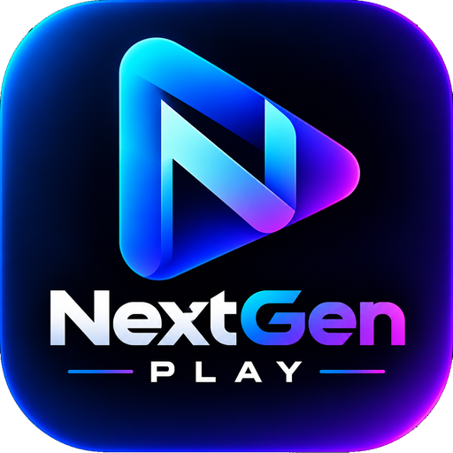

<h1 align="center">NextGen Play</h1>

An offline video player for Android with gesture controls, full ASS subtitles and Hinglish subtitle translation.

<!-- Screenshots go here once they are ready (docs/screenshots/). -->

## What it is

NextGen Play plays video files on your phone and links you type in yourself. It has no accounts, no ads and no analytics. It is built on Media3 / ExoPlayer.

## Highlights

- Gestures: swipe to seek, volume and brightness, double-tap, press and hold for 2x speed, pinch to zoom
- Subtitles: SRT, VTT, ASS/SSA with animated rendering, delay, styling, fonts and auto sync
- Optional subtitle translation, including Hinglish (Hindi in English letters). It asks for permission first
- Decoder modes HW, HW+ and SW, with automatic fallback when one fails
- Equalizer, volume boost, audio delay and remembered audio language
- Background play with notification controls, picture in picture, resume and sleep timer
- Library with folders, search and favourites, and a full Settings screen

## Download

Get the latest APK from the [Releases page](../../releases/latest). Android may show a Play Protect prompt for apps installed outside the Play Store. The app updates itself from the same page.

## Built with, and credits

NextGen Play stands on the work of these people and projects. Thank you.

| Project | By | Used for | Licence |
| :-- | :-- | :-- | :-- |
| [Media3 / ExoPlayer](https://github.com/androidx/media) | Google | Playback engine, player UI, HLS | Apache-2.0 |
| [libass](https://github.com/libass/libass) | libass contributors | ASS/SSA subtitle rendering | ISC |
| ass-media ([peerless2012](https://github.com/peerless2012)) | peerless2012 | Connects libass to Media3 | See its repository |
| [NextLib](https://github.com/anilbeesetti/nextlib) | Anil Kumar Beesetti | FFmpeg audio and video decoders for Media3 | GPL-3.0 |
| [FFmpeg](https://ffmpeg.org) | FFmpeg developers | The codecs inside NextLib | See NextLib |
| AndroidX Core, SwipeRefreshLayout | Google | Update install, pull to refresh | Apache-2.0 |
| [Poppins](https://github.com/itfoundry/poppins) | Indian Type Foundry | Bundled font | SIL Open Font License 1.1 |
| [bsdiff](https://www.daemonology.net/bsdiff/) | Colin Percival | Small patch updates | BSD |
| Google Translate web service | Google | Optional subtitle translation (service only) | Service terms |

Logo by the project owner.

## Privacy

Everything stays on your device. Read the full policy in the app under Settings > Privacy.

## Disclaimer

NextGen Play does not provide, host or link to any video content. It plays files on your device and links you enter yourself.

## Licence

GPL-3.0, because it includes NextLib (GPL-3.0). See [LICENSE](LICENSE).
