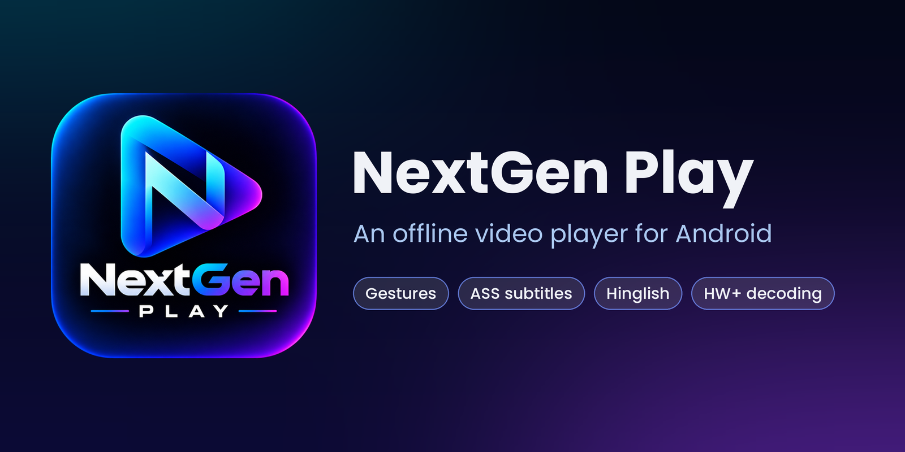
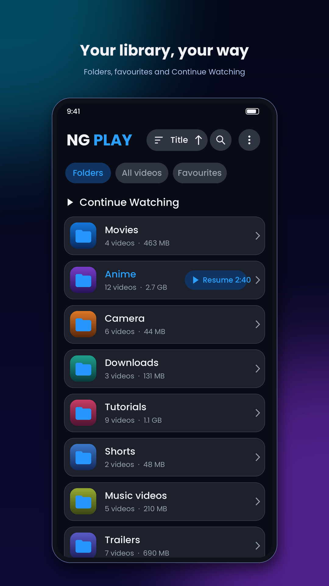
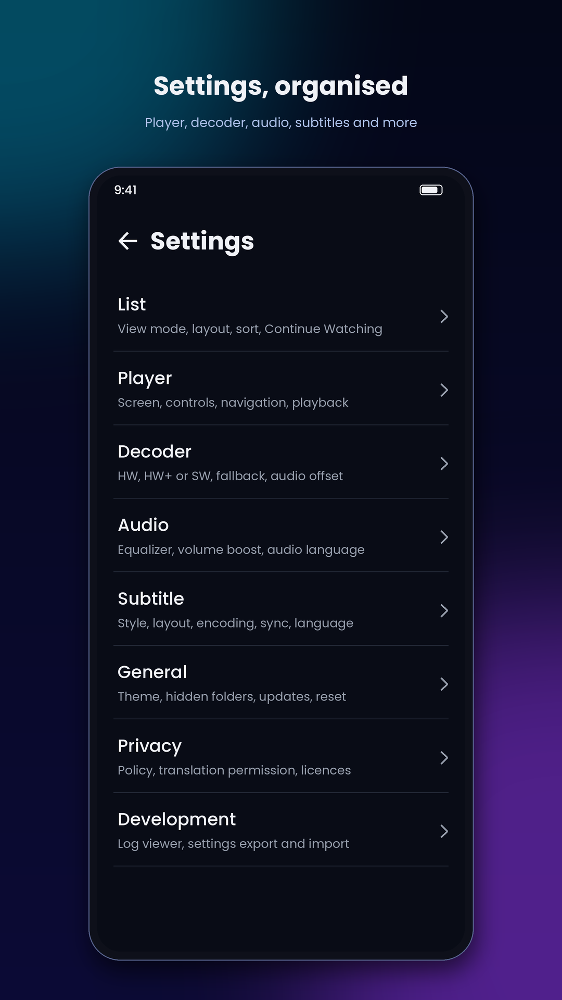
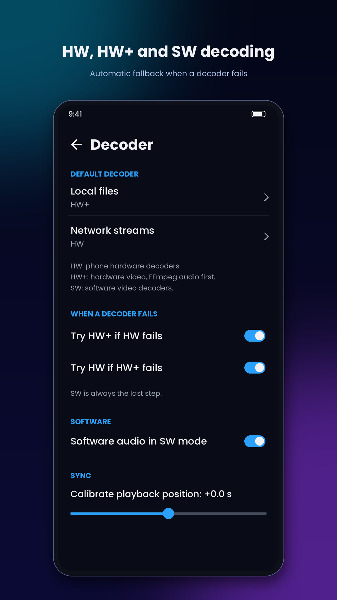
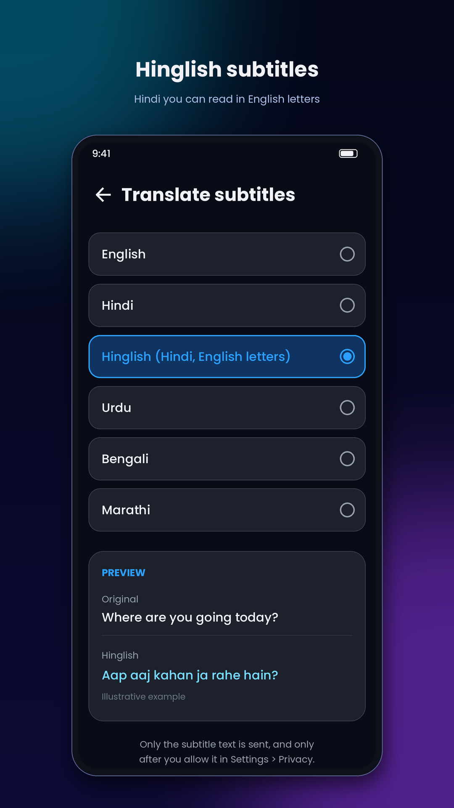
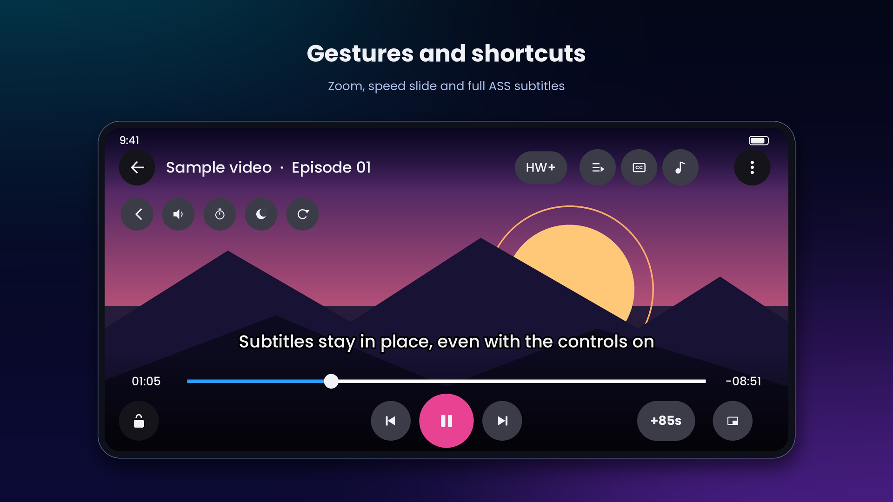

An offline video player for Android with gesture controls, full ASS subtitles and Hinglish subtitle translation.

## Preview

<table>
  <tr>
    <td width="25%"></td>
    <td width="25%"></td>
    <td width="25%"></td>
    <td width="25%"></td>
  </tr>
</table>

Preview images show the app's layout with sample content. They are illustrations, not captures of a real library. Tap an image to see it larger.

## What it is

NextGen Play plays video files on your phone and links you type in yourself. It has no accounts, no ads and no analytics. It is built on Media3 / ExoPlayer.

## Highlights

- **Gestures:** swipe to seek, volume and brightness, double-tap, press and hold for 2x (slide up or down to change the speed), pinch to zoom and pan
- **Subtitles:** SRT, VTT and ASS/SSA with animated rendering, delay, styling, fonts and auto sync
- **Translation:** optional subtitle translation, including Hinglish (Hindi in English letters). It asks for permission first
- **Decoders:** HW, HW+ and SW modes with automatic fallback when one fails
- **Audio:** equalizer, volume boost, audio delay and remembered audio language
- **Playback:** background play with notification controls, picture in picture, resume, sleep timer, A-B repeat
- **Library:** folders, search and favourites, with a full Settings screen
- **Tools:** log viewer and settings export and import

A short tour of every feature is in the [guide](docs/GUIDE.md).

## Download

Get the latest APK from the [Releases page](../../releases/latest). Android may show a Play Protect prompt for apps installed outside the Play Store. The app updates itself from the same page.

## Built with, and credits

NextGen Play stands on the work of these people and projects. Thank you.

| Project | By | Used for | Licence |
| :-- | :-- | :-- | :-- |
| [Media3 / ExoPlayer](https://github.com/androidx/media) | Google | Playback engine, player UI, HLS | Apache-2.0 |
| [libass](https://github.com/libass/libass) | libass contributors | ASS/SSA subtitle rendering | ISC |
| ass-media ([peerless2012](https://github.com/peerless2012)) | peerless2012 | Connects libass to Media3 | See its repository |
| [NextLib](https://github.com/anilbeesetti/nextlib) | Anil Kumar Beesetti | FFmpeg audio and video decoders for Media3 | GPL-3.0 |
| [FFmpeg](https://ffmpeg.org) | FFmpeg developers | The codecs inside NextLib | See NextLib |
| AndroidX Core, SwipeRefreshLayout | Google | Update install, pull to refresh | Apache-2.0 |
| [Poppins](https://github.com/itfoundry/poppins) | Indian Type Foundry | Bundled font | SIL Open Font License 1.1 |
| [bsdiff](https://www.daemonology.net/bsdiff/) | Colin Percival | Small patch updates | BSD |
| Google Translate web service | Google | Optional subtitle translation (service only) | Service terms |

Full notes are in [THIRD_PARTY_LICENSES.md](THIRD_PARTY_LICENSES.md), and the same list is inside the app under Settings > Privacy. The logo is by the project owner.

## Privacy

Everything stays on your device. The only things that go online are the update check, links you enter yourself, and subtitle text if you allow translation. Read the full policy in the app under Settings > Privacy.

## Disclaimer

NextGen Play does not provide, host or link to any video content. It plays files on your device and links you enter yourself.

## Licence

NextGen Play is free software under the **GNU General Public License v3.0**, because it includes NextLib, which is GPL-3.0. You can use, study, share and change it under that licence. The full text is in [LICENSE](LICENSE), and the source code is in this repository.

Copyright (C) 2026 The NextGen Play authors.
